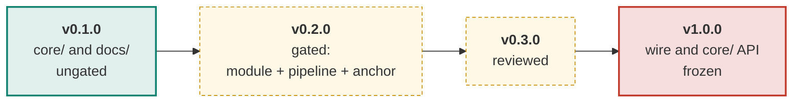
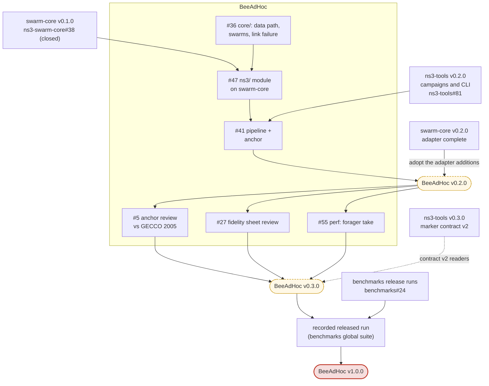

# Roadmap

The plan in one page. The live plan is this page plus the `release:` labels
below; issue state is always truer than a checked-in diagram. The ladder is the
maintainer's decision of 2026-11-11 ("adopt the release ladder and replace the
phase-targets rule"); the model is
[AntHocNet's roadmap](https://github.com/swarm-routing/AntHocNet/blob/main/docs/roadmap.md).
The cross-repo release train (which release of which repository waits for
which) is in the org [ROADMAP](https://github.com/swarm-routing/.github/blob/main/ROADMAP.md).

## How this plan is tracked

Each issue a release actually gates carries one **`release:` label**, so every
column of this plan is a live query rather than a diagram that drifts:

| Release | Board |
|---|---|
| v0.2.0 | [`release:v0.2.0`](https://github.com/swarm-routing/BeeAdHoc/issues?q=is%3Aopen+label%3A%22release%3Av0.2.0%22) |
| v0.3.0 | [`release:v0.3.0`](https://github.com/swarm-routing/BeeAdHoc/issues?q=is%3Aopen+label%3A%22release%3Av0.3.0%22) |
| v1.0.0 | [`release:v1.0.0`](https://github.com/swarm-routing/BeeAdHoc/issues?q=is%3Aopen+label%3A%22release%3Av1.0.0%22) |
| all epics | [`epic`](https://github.com/swarm-routing/BeeAdHoc/issues?q=is%3Aopen+label%3Aepic) |

Only issues the ladder gates are labelled; work that lands whenever it lands
carries no `release:` label. Releases are cut by
[`release.yml`](https://github.com/swarm-routing/BeeAdHoc/blob/main/.github/workflows/release.yml) and listed under
[Releases](https://github.com/swarm-routing/BeeAdHoc/releases). Majors are reserved for breaking changes; **1.0.0 is a
stability promise**.

## Release ladder

Green is shipped (v0.1.0, 2026-11-11); amber is planned. v0.1.0 came before the
comparator gates by maintainer decision 2026-11-10, so no number from it counts
as a benchmark result.

## What blocks what

Solid arrows are hard dependencies; dashed are "informs". Nodes outside this
repository are written `repo#N`.

BeeAdHoc v0.2.0 is one of the first two gated protocol releases (with ARA
v0.2.0), in wave B of the org release train: it needs ns3-tools v0.2.0 (every
protocol pipeline needs the campaign runner) and ns3-swarm-core v0.2.0. The
1.0.0 releases come last, swarm-core first, then ns3-tools, then each protocol
after its v0.3.0 review; they need a `reusable-release.yml` `increment` input
(MAJOR) in `swarm-routing/.github`.

## What each release must show to ship

| Release | Exit criteria |
|---|---|
| **v0.1.0** | `core/` and `docs/` released, ungated. **Shipped 2026-11-11** ([release v0.1.0](https://github.com/swarm-routing/BeeAdHoc/releases/tag/v0.1.0)). It has not cleared the comparator gates (org golden rule 6), so no number from it counts. |
| **v0.2.0** | **Gated.** The ns-3 module `beeadhoc` is green on swarm-core; the router observer is adopted; the protocol has its own benchmark pipeline; the anchor has a verdict (PASS, or a written infeasibility verdict); the rows of `docs/fidelity.md` that read `unknown: unresolved` (no issue owns them, such as the link-failure row) are each settled by a recorded reading or repo choice. The rows that wait on the papers (`unknown: open #5`, re-checked by [#5](https://github.com/swarm-routing/BeeAdHoc/issues/5) and [#27](https://github.com/swarm-routing/BeeAdHoc/issues/27)) are not a v0.2.0 prerequisite; they belong to v0.3.0. Scope: [#36](https://github.com/swarm-routing/BeeAdHoc/issues/36) the simulator-agnostic core (data path, swarms, link failure); [#47](https://github.com/swarm-routing/BeeAdHoc/issues/47) the `beeadhoc` contrib module; [#41](https://github.com/swarm-routing/BeeAdHoc/issues/41) the pipeline of paired smoke and anchor campaigns. The decision on the two Listing 13.15 interpretations, [#4](https://github.com/swarm-routing/BeeAdHoc/issues/4), is already closed (2026-11-10), so the anchor runs against the recorded reading. |
| **v0.3.0** | **Reviewed.** Paper-review issues and perf follow-ups are closed, and any new mechanism is default-off with its A/B. Scope: [#5](https://github.com/swarm-routing/BeeAdHoc/issues/5) the anchor reviewed against GECCO 2005; [#27](https://github.com/swarm-routing/BeeAdHoc/issues/27) the fidelity sheet reviewed against GECCO 2005 and SIS 2005 (needs the GECCO paper); [#55](https://github.com/swarm-routing/BeeAdHoc/issues/55) forager take without copies, span-based route tag. |
| **v1.0.0** | **Stability promise.** The wire format and the `core/` API are frozen; the protocol is paper-faithful with every deviation documented; the three comparator gates are passed; CI is green on the ns-3 release the org supports; a released run is recorded in the `benchmarks` global suite. |

[#3](https://github.com/swarm-routing/BeeAdHoc/issues/3), the standalone-protocol epic, stays open until v0.2.0 ships.

## Infrastructure track

Work on CI, packaging and docs rides along with the release it fits and
carries its label if one applies, but never gates a release's exit criteria.
None is open here today; add rows as such issues appear.

| release | issue | what |
|---|---|---|
| | | none yet |

## Deliberate non-goals

- **After 1.0:** [#9](https://github.com/swarm-routing/BeeAdHoc/issues/9), the BeeSec / BeeAIS secure swarm comparator (Mazhar & Farooq 2007), and anything else not named above.
- **The formal model's packers and dance-floor recruitment** (PG 460 ch. 4) are out of scope; adding them later is a default-off mechanism with its own A/B (see the [README](../README.md) and [`docs/fidelity.md`](fidelity.md)).
- **No version labels on unscheduled work.** An issue that lands whenever it lands is not put on the ladder.

## See also

- [Org ROADMAP](https://github.com/swarm-routing/.github/blob/main/ROADMAP.md): the cross-repo release train and the phases.
- [CONTRIBUTING](https://github.com/swarm-routing/.github/blob/main/CONTRIBUTING.md): invariants, labels and issue shape.
- [`docs/fidelity.md`](fidelity.md): paper section to implementation, and the `unknown: unresolved` rows v0.2.0 settles.
- [AntHocNet's roadmap](https://github.com/swarm-routing/AntHocNet/blob/main/docs/roadmap.md): the ladder this one follows.
